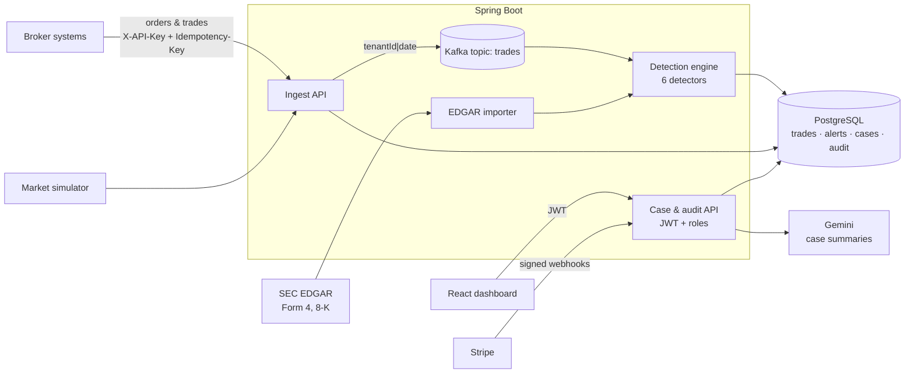

# MarketSentinel

Trade-surveillance SaaS for US broker-dealers. Brokers send their orders and trades; MarketSentinel detects market manipulation, scores it, and gives compliance analysts a dashboard to investigate, with an append-only audit trail regulators can rely on.

**Stack:** Java 21 · Spring Boot 4 · Spring Security (JWT + API keys) · Spring Data JPA · PostgreSQL · Flyway · Kafka · JUnit 5 + Testcontainers · React 19 + TypeScript · TanStack Query · Recharts · Stripe · SEC EDGAR · Gemini · Docker · GitHub Actions

<!-- Add a 60-second demo GIF here: docs/demo.gif -->

## What it detects

| Pattern | What it is | How it is detected |
|---|---|---|
| **Wash trading** | Trading with yourself to fake volume | Same beneficial owner on both sides of 3+ trades (linked accounts count as one owner) |
| **Spoofing / layering** | Fake large orders that move the price, cancelled before they fill | 3+ orders ≥ 5× the median size, cancelled within 10 s, plus real trades on the opposite side within 60 s |
| **Marking the close** | Trading at the end of the day to push the closing price | ≥ 60 % of the account's volume in the last 10 min, ≥ 20 % of the market's closing volume, price moved ≥ 1 % its way |
| **Pump and dump** | Buy cheap, hype, sell to the new buyers | Intraday rise ≥ 15 %; accounts with ≥ 10 % of the cheap-side buying that sold ≥ 70 % of it near the top |
| **Front-running** | An employee trading ahead of a big client order | Employee or proprietary trade on the same side within 5 min before a ≥ 10,000-share client order (more risk if reversed afterwards) |
| **Insider buying before news** | Buying before price-sensitive announcements | Real SEC data: Form 4 open-market purchase (code P) within 10 days before an 8-K with items 1.01, 1.02, 2.01, 2.02, 5.01, 5.02 or 8.01 |

Every threshold is in `application.yml`, so it can be tuned without code changes. Each alert has a 0–100 risk score, a plain-English reason and the evidence numbers behind it.

## Architecture



- **Detectors are pure functions** of a trading day (`MarketDay` in, `Finding`s out). They never touch the database, so each is unit-tested with hand-made trades.
- **Ingestion is decoupled from detection.** In `kafka` mode the ingest API publishes a small event and returns; the detection engine consumes the topic and re-runs detection for that firm's day. Many trades for one day collapse into one run. `inline` mode does the same in-process, for simple hosting.
- **Detection is re-runnable.** Each finding has a fingerprint with a unique constraint, so running a day twice never creates duplicate alerts. Kafka's at-least-once delivery is therefore harmless.

## Engineering details worth knowing

- **Exact money:** prices are `BigDecimal` in Java and `NUMERIC(19,4)` in PostgreSQL, never floating point.
- **Idempotent ingest:** every write carries an `Idempotency-Key`. A retry returns the stored result (`200`, `Idempotent-Replayed: true`); the same key with a different payload is rejected (`422`). A `UNIQUE (tenant_id, idempotency_key)` constraint makes it hold even under simultaneous retries.
- **Multi-tenancy:** every table has `tenant_id`, and the tenant always comes from the authenticated token or API key, never from the request. Another firm's alert returns `404`, not its data. Covered by an integration test.
- **Two security chains:** broker systems use API keys (stored as SHA-256 hashes, shown once) on `/api/v1/ingest/**`; people use JWTs with four roles. Analysts work cases, supervisors approve and report, auditors can only read, admins manage users, keys and billing. Rules are enforced on the server with `@PreAuthorize`.
- **Append-only audit trail:** every action is recorded in the same transaction as the change. A PostgreSQL trigger rejects `UPDATE` and `DELETE` on `audit_events`, so not even direct SQL can rewrite history.
- **Human-in-the-loop AI:** Gemini drafts case summaries from the evidence only, in a fixed JSON schema, with a 10 s limit per model and a lighter fallback model. A supervisor must approve the text; edits are audited.
- **Safe external data:** the EDGAR client sends the SEC's required User-Agent and stays under its rate limit; the Form 4 XML parser disables DOCTYPEs and external entities (XXE protection).
- **Billing you can trust:** Stripe Checkout and the customer portal for upgrades; a firm's plan changes only from a signature-verified webhook, and each webhook event is applied once. Plans cap trades per month (Free 10k, Pro 1M), counted with an atomic upsert.
- **Rate limits** per IP, with a tight limit on login and signup.

## Run it locally

Requirements: Java 21+, Node 22+, Docker.

```bash
cp .env.example .env            # put your name and email in SEC_USER_AGENT
docker compose up -d            # PostgreSQL on localhost:5434
cd backend && ./mvnw spring-boot:run      # API on :8080
cd frontend && npm install && npm run dev # dashboard on :5174
```

Open http://localhost:5174 and sign in as one of the demo users (password `Sentinel#2026`):
`analyst@`, `supervisor@`, `auditor@`, `admin@demo.marketsentinel.dev`. On the overview page, click **Run market day**: about 2,400 trades are generated across 20 made-up tickers with five schemes hidden inside, and the detectors find them.

**Everything in containers, with Kafka:**

```bash
docker compose --profile full up -d --build   # API :8080 (Kafka mode), dashboard :8081
```

## Send trades like a broker would

Create an API key on **Team & API keys** (admin), then:

```bash
curl -X POST http://localhost:8080/api/v1/ingest/accounts -H "X-API-Key: $KEY" -H "Content-Type: application/json" \
  -d '[{"accountRef":"R1","ownerRef":"SHELL-CO","accountType":"CLIENT"},{"accountRef":"R2","ownerRef":"SHELL-CO","accountType":"CLIENT"}]'

curl -X POST http://localhost:8080/api/v1/ingest/trades -H "X-API-Key: $KEY" -H "Idempotency-Key: t-1" -H "Content-Type: application/json" \
  -d '{"tradeRef":"T-1","symbol":"ZETA","buyAccountRef":"R1","sellAccountRef":"R2","price":"25.00","quantity":5000,"executedAt":"2026-10-21T15:00:00Z"}'
```

Send a few such trades between `R1` and `R2`, and a wash-trading alert appears within about 10 seconds.

**Real SEC data:** on **SEC filings**, import tickers (for example a few small or mid-size companies, where insiders buy more often than at mega-caps). MarketSentinel pulls their Form 4 and 8-K filings from EDGAR and screens for insider buying before news.

## Tests

```bash
cd backend && ./mvnw verify   # 32 tests
```

- Each detector: a clean case, an obvious case, and a borderline case just under the threshold.
- The simulator end to end, with four different seeds: every hidden scheme is detected on the right ticker.
- Form 4 parsing, including a rejected XXE payload.
- Integration tests against PostgreSQL in Docker (Testcontainers) over real HTTP: tenant isolation, idempotent ingest, validation and API-key auth.

GitHub Actions runs the backend tests, lints and builds the dashboard, and builds both Docker images on every push.

## Deploy (free tiers)

1. **PostgreSQL:** create a free database on [Neon](https://neon.tech). Use its JDBC form: `DATABASE_URL=jdbc:postgresql://<host>/<db>?sslmode=require`, plus `DATABASE_USER` and `DATABASE_PASSWORD`.
2. **API on Render:** New → Blueprint → this repo (uses `render.yaml`, Docker). Fill in the database values, `SEC_USER_AGENT`, and optionally `GEMINI_API_KEY` and Stripe test keys. `JWT_SECRET` is generated for you.
3. **Dashboard on Vercel:** import the repo with root directory `frontend`, set `VITE_API_URL` to the Render URL.
4. On Render, set `CORS_ORIGINS` and `APP_URL` to the Vercel URL.

Stripe (optional): create Pro and Enterprise prices in **test mode**, set `STRIPE_SECRET_KEY`, `STRIPE_PRICE_PRO`, `STRIPE_PRICE_ENTERPRISE`, and add a webhook to `https://<api>/api/v1/billing/webhook` for `checkout.session.completed` and `customer.subscription.*`; put its signing secret in `STRIPE_WEBHOOK_SECRET`.

## Limitations

- The simulator uses made-up tickers; detection on real market data would need a market-data feed.
- Detectors are rule-based screens, not proof: an alert is a reason to look, and analysts decide.
- The insider screen does not yet check the price reaction after the 8-K (no free intraday price source is used).
- Rate limits and pending detections are kept in memory: fine for one instance, Redis for several.
- In `inline` mode, detections pending at shutdown are lost until new data arrives for that day; `kafka` mode keeps them in the topic.
